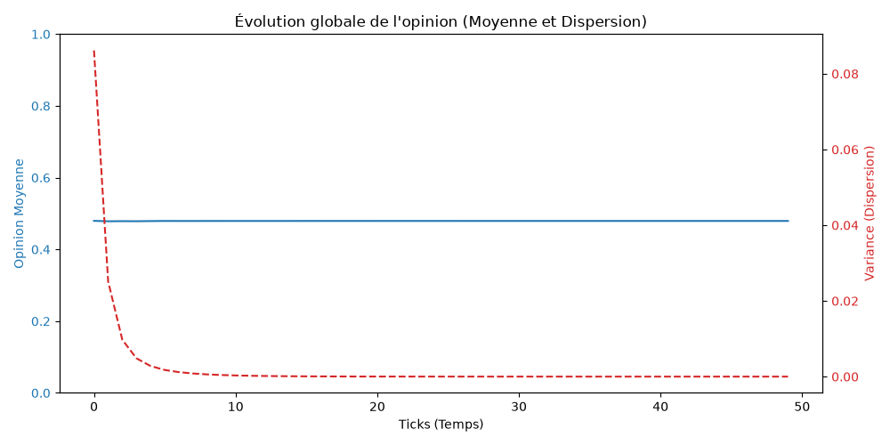
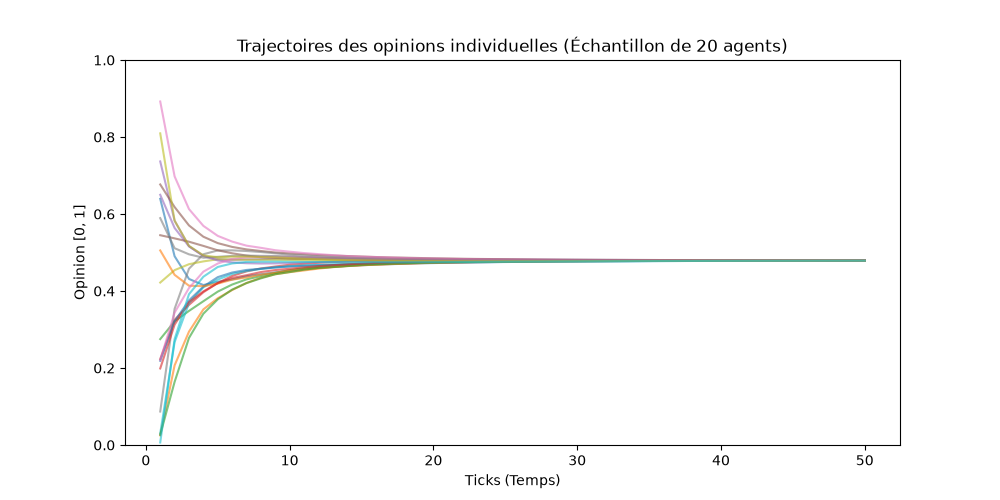

# TP 2 — Formation de l’opinion publique avec Mesa

## 1. Introduction

Ce TP porte sur la simulation de la formation et de l’évolution de l’opinion publique à l’aide d’un système multi-agents (SMA).

L’objectif est de modéliser un ensemble d’agents possédant chacun une opinion individuelle, puis d’observer comment les interactions entre agents font évoluer ces opinions au cours du temps.

La simulation est réalisée en Python avec le framework **Mesa**, spécialisé dans la modélisation et la simulation de systèmes multi-agents.

---

## 2. Objectifs

Les principaux objectifs de ce TP sont :

- Comprendre le principe d’un système multi-agents.
- Modéliser des agents possédant une opinion.
- Simuler l’évolution des opinions au cours du temps.
- Observer l’influence des interactions entre agents.
- Mesurer l’évolution globale de l’opinion.
- Analyser la moyenne et la dispersion des opinions.
- Visualiser les trajectoires individuelles des agents.
- Utiliser les résultats d’une simulation pour analyser un phénomène collectif.

---

## 3. Technologies utilisées

- **Python**
- **Mesa 3**
- **NumPy**
- **Pandas**
- **Matplotlib**

---

## 4. Principe de la simulation

Chaque agent possède une opinion représentée par une valeur comprise entre **0 et 1**.

Au cours de la simulation, les agents interagissent et leurs opinions évoluent progressivement en fonction des interactions avec les autres agents.

La simulation est exécutée pendant plusieurs pas de temps (*ticks*).

Deux niveaux d’analyse sont utilisés :

1. **Analyse globale** : évolution de la moyenne et de la dispersion des opinions.
2. **Analyse individuelle** : évolution de l’opinion de plusieurs agents au cours du temps.

---

## 5. Analyse des résultats

### 5.1 Évolution globale de l’opinion

La première figure représente l’évolution de la moyenne des opinions ainsi que leur dispersion au cours des ticks.

**Figure 1 — Évolution globale de l’opinion (moyenne et dispersion)**

On observe que la moyenne de l’opinion reste proche de **0,48** pendant toute la simulation.

En revanche, la dispersion diminue rapidement au début de la simulation, puis se stabilise à une valeur très faible.

Cela montre que les opinions individuelles deviennent progressivement plus proches les unes des autres, tandis que la moyenne globale reste relativement stable.

---

### 5.2 Trajectoires des opinions individuelles

La deuxième figure présente l’évolution des opinions individuelles d’un échantillon de **20 agents**.

**Figure 2 — Trajectoires des opinions individuelles**

Au début de la simulation, les agents présentent des opinions différentes, avec des valeurs réparties sur une grande partie de l’intervalle `[0,1]`.

Au fur et à mesure des interactions, les trajectoires convergent progressivement vers une valeur proche de **0,48**.

Cette convergence confirme le résultat observé dans la première figure : la dispersion des opinions diminue fortement tandis que le système tend vers un état collectif plus homogène.

---

## 6. Interprétation

Les résultats montrent un phénomène de **convergence des opinions**.

Au début, les agents ont des opinions relativement différentes. Les interactions successives réduisent progressivement ces différences.

Deux phénomènes peuvent donc être observés :

- **Convergence individuelle** : les opinions des agents se rapprochent progressivement les unes des autres.
- **Stabilisation collective** : la moyenne globale reste proche d’une valeur stable autour de 0,48.

La diminution de la dispersion constitue un indicateur important de cette convergence.

---

## 7. Conclusion

Ce TP a permis de mettre en pratique les principes fondamentaux d’un **système multi-agents** à travers la simulation de la formation d’une opinion collective.

La simulation montre comment des interactions locales entre agents peuvent produire un comportement collectif : les opinions initialement différentes convergent progressivement vers une valeur commune.

L’utilisation de **Mesa** permet ainsi de représenter, exécuter et analyser ce type de phénomène de manière expérimentale.